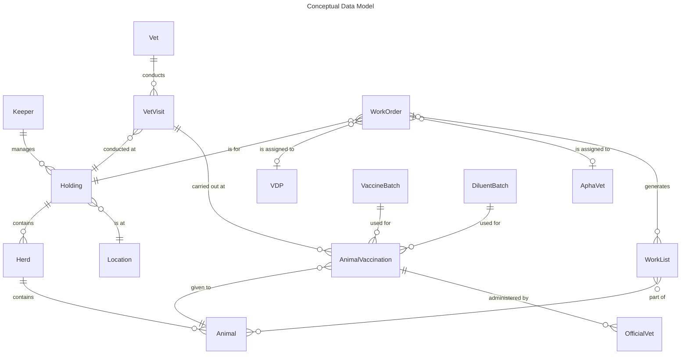
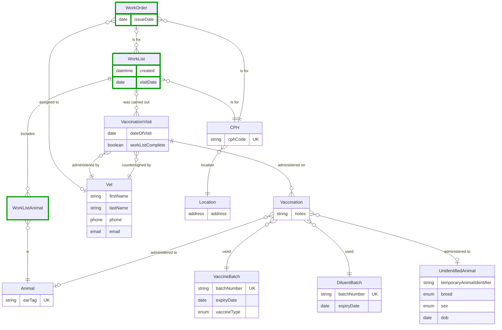
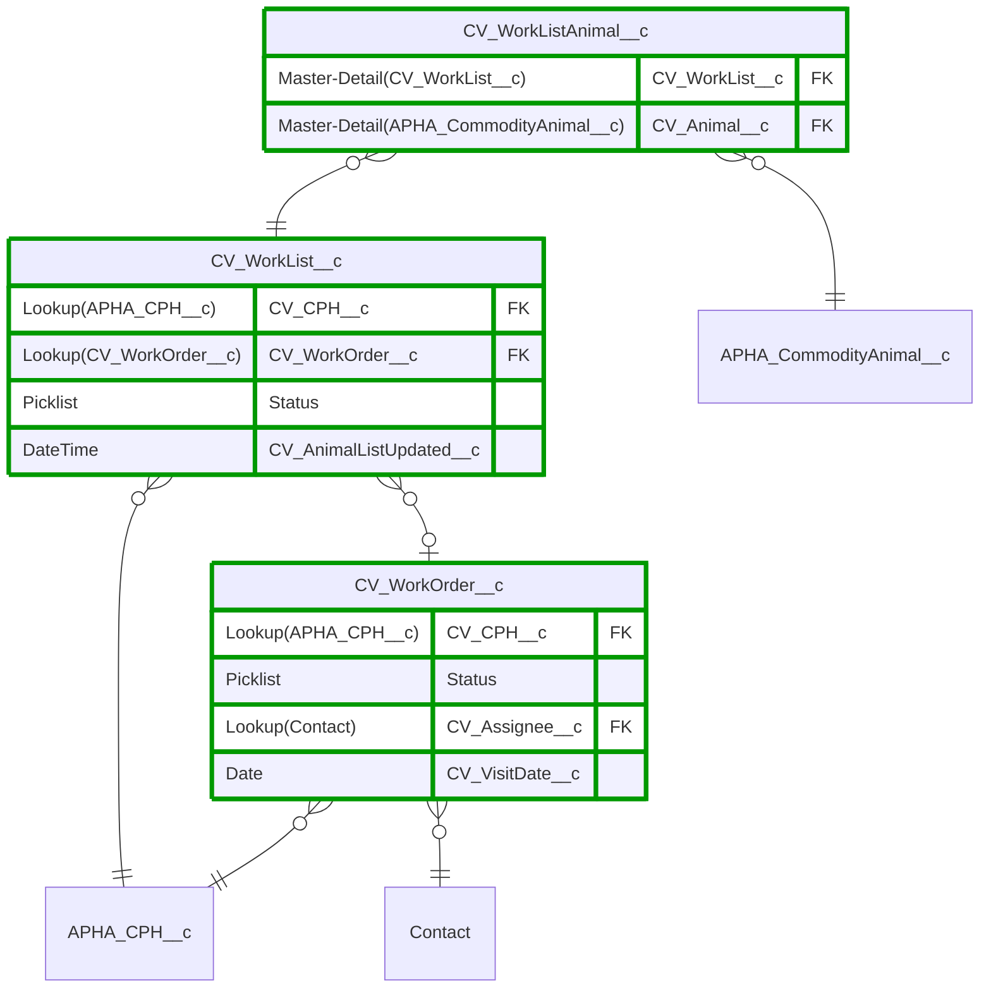

<!-- Space: CVAC -->
<!-- Parent: Delivery Passport -->
<!-- Parent: Technology View -->
<!-- Parent: Data Architecture -->

# Data Structure View

A _structure view_ covers how information is organised: domains, conceptual and logical models, canonical definitions and how data is exchanged (events, APIs, files). It answers what the data is and how pieces relate, not yet where bytes live (see [Physical View](../physical-view/README.md)).
<!-- Include: ac:toc -->

## Legacy Data

The legacy system is Sam. See [Data Structure View - Sam](./sam/README.md) for detailed information regarding the relevant areas of Sam.

## Conceptual Data Domains

This conceptual view shows the primary data domains and ownership boundaries across the cattle vaccination landscape.




## Logical Data Model

This logical view describes how core entities relate across the TB workflow.

### Vaccination Work List

> Note: Future entities are shown in green



## Salesforce (Physical) Data Model

This section defines the core Salesforce objects, their key fields and relationships in an ERD-style view.

### Work Order and Work List


## Data Exchange Boundaries

This exchange view maps the data contracts and transfer mechanisms between bounded contexts. All exchanges are synchronous HTTPS — there are no events, queues or topics.

TBD

<!-- ```mermaid
flowchart LR
  Backend(CattleVaccinationBackend)
  AphaBridge(AphaIntegrationBridge)
  AphaApi(AphaApi)
  LivestockApi(LivestockApi)
  SalesforceOrg(SalesforceOrg)

  Backend -->|"POST /holdings/find, GET /workorders"| AphaBridge
  AphaBridge -->|"proxies HTTPS"| AphaApi
  Backend -->|"GET /cattle-on-holding"| LivestockApi
  Backend -->|"REST API v62.0 — Case, APHA_TestPart__c, APHA_TestPartResult__c"| SalesforceOrg
```
-->
